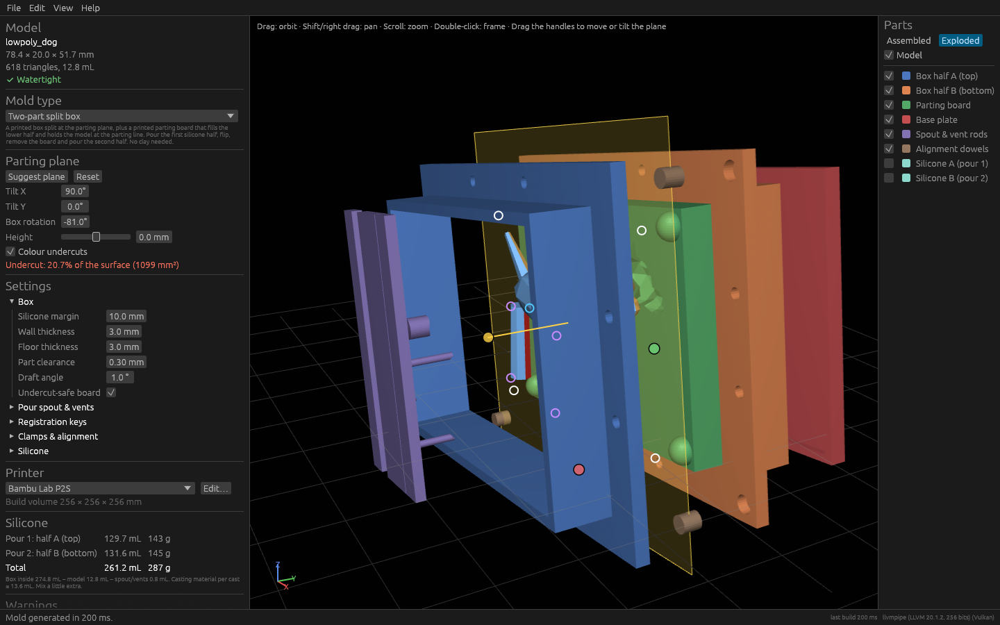

# MoldWeaver

MoldWeaver turns a 3D model into 3D-printable mold boxes for silicone casting.
It is a free, open-source (GPL-3.0-or-later) alternative to
[MoldBoxer](https://moldboxer.com) for Linux.

Load a model, place the parting plane (or let MoldWeaver suggest one), tune the
settings with a live preview, and export **one 3MF** with every mold part laid out on
your printer's plate, ready for Bambu Studio or OrcaSlicer.



## Features (phase 1)

* **Import** STL (binary and ASCII), OBJ and 3MF (including Bambu/Orca project files
  with components). Shows dimensions and volume, and warns if the mesh is not
  watertight. **Repair mesh** welds vertices, drops broken faces, fixes flipped faces
  and fills holes.
* **3D viewport** (wgpu: Vulkan, with automatic fallback to OpenGL): orbit, pan and
  zoom, assembled or exploded view, and a visibility toggle for each part.
* **Parting plane**: drag the arrow handle to move it, drag the two round handles to
  tilt it, or type the values. **Suggest plane** searches about 170 orientations and 64
  heights for the least undercut area. Among near-ties it keeps the parting line on the
  widest section, then turns the box to the smallest footprint.
* **Undercut colouring**: red faces would lock into the silicone for the current pull
  directions. Blue faces belong to the upper half and orange faces to the lower half.
* **Mold types**
  * *Two-part split box*: a printed box split at the parting plane, with a **printed
    parting board** that fills the lower half and holds the model at the parting line.
    You pour half A, flip, remove the board and pour half B, with no clay needed.
    Settings: silicone margin, wall and floor thickness, part clearance, draft, and an
    *undercut-safe board* option. That option shapes the board so it can always be
    pulled straight off the model.
  * *Open tray (one-part)*: a walled box on a base plate for flat-backed models.
    Settings: margin, wall height above the model, wall thickness, draft, and an
    optional detachable base.
* **Features**
  * Pour spout with a funnel. It is auto-placed at the centre of the model's top, or you
    can type a position or click the model. Air vents start at the model's local high
    points (relative to the casting direction) and run straight out of the mold. Both
    diameters are adjustable, and the rods print as one part that rests on the box.
  * Registration keys (hemispheres or cones) on the parting board. Size, count, corner
    or even placement, and distance from the wall are adjustable. The box halves line up
    with printed dowels in corner sockets.
  * Flanges with M3/M4 bolt holes or zip-tie slots, or printed slide-on clamps. Holes
    include a printing tolerance and are compensated for polygon faceting.
  * Silicone estimate in mL and grams, split per pour, with editable density (default
    1.1 g/mL) and an optional price per kg. It also estimates the casting material per
    cast.
* **Printer profiles** stored as data (`crates/moldweaver-core/data/printers.json`),
  with presets for the *Bambu Lab P2S* (256 × 256 × 256 mm) and the *Creality Ender 3 V3
  SE* (220 × 220 × 250 mm). You can add your own in *Edit ▸ Printers*; they are saved to
  `~/.config/moldweaver/printers.json`. MoldWeaver warns when a part does not fit the
  build volume.
* **Projects**: a versioned JSON format with the model path (or the embedded mesh),
  plane, mold type, every parameter and the printer.
* **Undo/redo** (Ctrl+Z / Ctrl+Shift+Z), plain-language tooltips on every setting, and a
  quick guide in *Help*.
* **Headless batch mode** for scripts and CI.
* Geometry rebuilds on a background thread, debounced by 300 ms. The window stays
  responsive and only the newest request is computed.

## Building and running

You need a recent stable Rust (tested with 1.97) and a C toolchain for a few build
scripts. On Fedora:

```sh
sudo dnf install gcc
curl https://sh.rustup.rs -sSf | sh     # if you do not have Rust yet
git clone https://github.com/kirmiziben10/moldweaver
cd moldweaver
cargo run --release                     # opens the window
cargo run --release -- model.stl        # opens a model (or a project .json)
```

The window needs Vulkan or OpenGL drivers; both work on Mesa and on the NVIDIA
proprietary driver. MoldWeaver tries Vulkan first and falls back to OpenGL by itself.
To force a backend:

```sh
WGPU_BACKEND=gl cargo run --release     # or WGPU_BACKEND=vulkan
```

### Command line / batch mode

```sh
moldweaver --batch project.json -o out.3mf                 # from a project file
moldweaver --batch model.stl -o out.3mf --suggest          # model with default settings
moldweaver --batch project.json -o out.3mf \
    --printer "Creality Ender 3 V3 SE" --set margin=12 --set clamp_style=zip \
    --report report.json --export-stl parts/
moldweaver --list-params                                   # every mold type and parameter
```

`--report` writes a JSON file with parts, volumes, plate layout and warnings. `--repair`
repairs the mesh before generating, and `--mold open_tray` picks the mold type.

### Tests

```sh
cargo test --workspace            # unit, analytic geometry and golden CLI tests
cargo clippy --workspace --all-targets
UPDATE_GOLDEN=1 cargo test -p moldweaver --test cli_golden   # refresh tests/golden/*.json
```

* Unit tests cover the mesh, I/O, analysis, parameters, layout, printers and projects.
* Geometry tests (`crates/moldweaver-core/tests/geometry.rs`) check the cube and sphere
  cavity and silicone volumes against formulas, draft frustums, that keys line up across
  halves, that bolt holes are symmetric and go through both flanges, that the
  undercut-safe board pulls off the dog without collision, and that every part is a
  watertight manifold.
* Golden tests (`crates/moldweaver/tests/cli_golden.rs`) run the real binary on the
  fixtures in `tests/fixtures/` (cube, sphere, low-poly dog with undercuts, dog tray).
  They check part count, manifold status and volumes against `tests/golden/`. They also
  check that the 3MF is a well-formed zip/XML package and that every object is
  watertight, on the plate and not overlapping another.

`cargo run -p moldweaver-core --example make_fixtures` regenerates the fixture models.

## Flatpak

The Flatpak uses `org.freedesktop.Platform` 25.08 with the `rust-stable` SDK extension
and builds offline from vendored crates:

```sh
sudo dnf install flatpak flatpak-builder
flatpak/build.sh --install      # vendors crates, builds, installs for your user
flatpak run io.github.moldweaver.MoldWeaver
```

`flatpak/build.sh` adds Flathub (user scope) and installs the runtime, SDK and Rust
extension. It then runs `cargo vendor` into `flatpak/vendor`, writes the cargo
source-replacement config, runs `flatpak-builder` and creates
`flatpak/moldweaver.flatpak`. The manifest is
`flatpak/io.github.moldweaver.MoldWeaver.yml`. The desktop file, metainfo and icon are in
`data/`.

> **Not tested end to end.** The cloud environment this was built in cannot reach
> Flathub, so `flatpak-builder` was never run. What *was* checked: the manifest parses
> (`flatpak-builder --show-manifest`), the desktop file passes `desktop-file-validate`,
> the metainfo passes `appstreamcli validate`, and the exact build commands from the
> manifest succeed offline against the vendored crates (`cargo --offline build --release
> --locked` with an empty `CARGO_HOME` and no network).

## User guide: a two-part pour with the parting board

You need the printed parts, two-component silicone (platinum or tin), mold release, the
model you want to copy, and the fasteners you chose (M3/M4 bolts and nuts, zip ties, or
the printed clamps).

1. **Open the model** (Ctrl+O). If it says *Not watertight*, click **Repair mesh**.
2. **Choose the parting plane.** Pick *Two-part split box* and click **Suggest plane**.
   Red areas are undercuts: places where silicone would hook behind the model. Silicone
   stretches, so small red areas are fine. Drag the yellow arrow to move the plane and
   the round handles to tilt it, then check how the red area changes.
3. **Tune the settings.** Hover any setting to see what it does. 8–15 mm of silicone
   margin suits most models. The mold rebuilds automatically, and the *Silicone* section
   shows how much to mix for each pour.
4. **Export 3MF** (Ctrl+E), open it in Bambu Studio or OrcaSlicer and print everything.
   Parts come already in print orientation and need no supports. PLA or PETG with 3–4
   walls works well.
5. **Pour 1 (half A, top).**
   1. Put the **base plate** on a level table and lay the **parting board** on it, with
      the model's cut-out facing up.
   2. Lower **box half B** (flange up) over the board into the rim of the base plate.
      The walls taper, so it only fits one way.
   3. Press the model into the board's cut-out. It should sit exactly at the parting
      line; a dab of hot glue or wax keeps it still.
   4. Push the **alignment dowels** into the corner sockets, put **box half A** on top
      and fasten the flanges.
   5. Rest the **spout & vent rods** on top of half A so the rods touch the model.
   6. Spray mold release. Mix silicone A and pour it slowly into a corner (not onto the
      model) until it reaches the top rim. Let it cure.
6. **Pour 2 (half B, bottom).**
   1. Pull out the rods. Flip the whole box over and lift off the base plate.
   2. Pull the parting board out. The model stays embedded in silicone A, and the key
      bumps have left dimples in silicone A.
   3. **Apply mold release to silicone A**, because silicone sticks to silicone.
   4. Pour silicone B until it reaches the rim of half B and let it cure.
7. **Demold.** Undo the fasteners, separate the halves, push each silicone half out of
   its ring towards the open end, and take the model out.
8. **Cast.** Put the silicone halves back into their rings (the keys line them up), close
   the box, set it on the base plate with half B down, and pour resin through the funnel.
   The vents let trapped air out.

### Open tray (one-part)

Pick *Open tray*. The plane becomes the **base plane**, and **Suggest plane** looks for
a large flat face to stand the model on. If the model has none, part of it is cut off so
the cast gets a flat back. Glue the model's back to the tray floor (or to the plug of the
detachable base), spray release and fill to the brim. To cast, flip the cured silicone
and pour resin into the open back.

## How it works / project layout

```
crates/moldweaver-core   geometry library (no UI)
  mesh.rs       TriMesh, topology report, repair, manifold conversion
  io/           STL / OBJ / 3MF readers, 3MF writer and validator
  frame.rs      parting plane and the mold coordinate frame (plane = z 0)
  analysis.rs   vertical-ray grid, undercut classification, plane suggestion
  molds/        MoldType trait, parameter schema, shared features,
                two_part.rs and open_tray.rs
  layout.rs     print orientation, MaxRects plate packing, 3MF export
  printer.rs    printer profiles (data/printers.json)
  project.rs    versioned project files
  pipeline.rs   load -> generate -> layout, shared by GUI and CLI
crates/moldweaver        the app: CLI (cli.rs) and GUI (gui/)
```

Every mold type implements one trait:

```rust
pub trait MoldType: Send + Sync {
    fn id(&self) -> &'static str;              // stored in project files
    fn name(&self) -> &'static str;
    fn description(&self) -> &'static str;
    fn plane_usage(&self) -> PlaneUsage;       // Split (two halves) or Base (one-sided)
    fn param_specs(&self) -> Vec<ParamSpec>;   // drives the UI, CLI and project files
    fn generate(&self, input: &MoldInput) -> Result<MoldOutput>; // named parts + volume report
}
```

Parameters are declared as data (`ParamSpec`: kind, range, unit, default, tooltip,
group, visibility condition). The GUI renders them generically, the CLI parses them with
`--set`, and project files store them as a key/value map. A new mold type, such as the
planned phase 2 *multi-part silicone jacket with a mother mold* or the phase 3
*slip-casting mold with a removable core*, is a new module added to
`molds::registry()`. The UI, export and project code stay untouched. Every generator
works in the **mold frame**, where the parting plane is `z = 0` and the upper half pulls
up along `+Z`. The frame transform handles the user's tilt and rotation.

### Geometry library

Booleans, trims, hulls and volumes use **[manifold-rust](https://crates.io/crates/manifold-rust)
0.18**, a pure-Rust port of the Manifold library. I checked that it exists and builds
before relying on it. Its robust winding-number engine also powers *Repair mesh* (as a
last resort) and the undercut-safe board.

## Known limitations

* **Not tested on real hardware.** The GUI was exercised under Xvfb with Mesa's software
  renderer (llvmpipe) on both Vulkan and OpenGL: loading, plane suggestion, gizmo drags,
  undo/redo, exploded view, the printers dialog and opening projects. It was not run on
  KDE Wayland or an NVIDIA GTX 1650.
* **Slicers not tested.** The exported 3MF follows the 3MF core spec and passes the
  structural checks above, but it was not opened in Bambu Studio or OrcaSlicer (they are
  not available in the build environment). Parts that do not fit together on one plate
  are placed next to it with a warning; no slicer multi-plate metadata is written.
* **The Flatpak build is untested** (see above).
* The parting surface is a single flat plane. There are no stepped or curved parting
  lines.
* Undercut detection classifies whole triangles by their centroid, so the colouring is
  coarse along the parting line on low-poly meshes. Faces within about 1° of vertical
  count as releasing because silicone stretches. Plane suggestion samples a fixed set
  of directions; it does not optimise continuously.
* The split of silicone between pour 1 and pour 2 is exact unless the lower half of the
  model has undercuts. In that case silicone A also fills the gaps the undercut-safe
  board leaves, and the per-pour figures are estimates (the total is exact).
* Vents are straight vertical channels. Air traps under an overhang get no vent, and you
  get a warning instead. Vents are only made above the parting plane (casting from the
  top). The open tray has no pour spout (its open back is the pour opening), and
  registration keys only exist on the two-part box.
* Boxes are rectangular, so silicone use is higher than with a form-fitting jacket. That
  is phase 2.
* Mesh repair is basic: holes are closed with simple fans, and badly self-intersecting
  meshes may still fail. Very large meshes (several hundred thousand triangles) make
  generation take several seconds or more.
* Printed clamps, dowels and the default tolerances have not been printed and tried.
  You may need to adjust *Printing tolerance* and *Part clearance* for your printer.
* Undo/redo covers the plane, the mold type, the settings and the printer, but not
  loading or repairing the model.
* OBJ files are assumed to be in millimetres.

## License

GPL-3.0-or-later. See [LICENSE](LICENSE).
